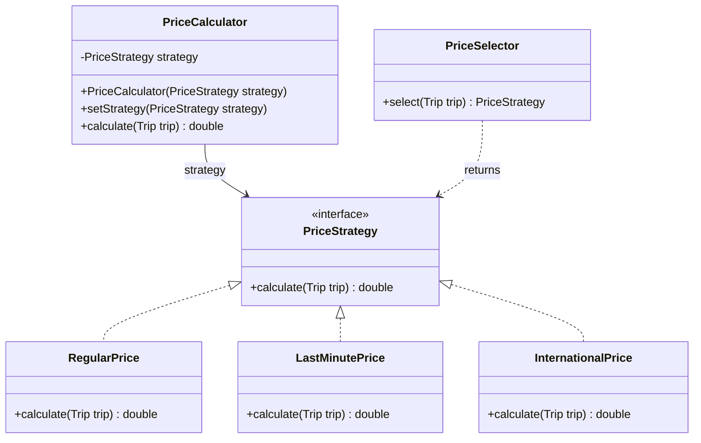
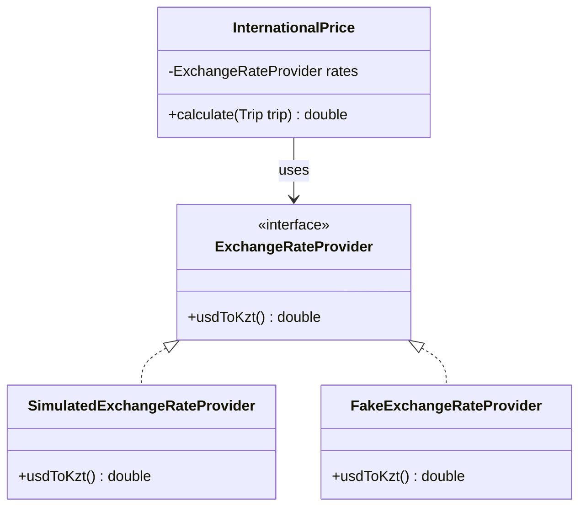
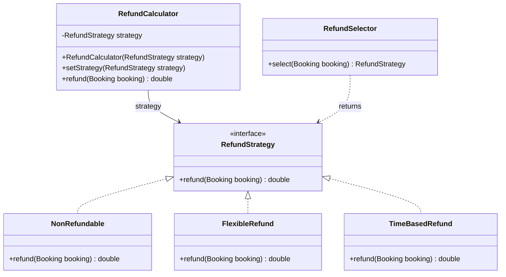

# Flight Reservation: Strategy Pattern (Assignment 5)

Domain: **flight reservation**. Two families of interchangeable algorithms use the Strategy pattern.

| Family | The job that can be done in different ways | Strategies |
|---|---|---|
| **Price** | calculate the ticket price | `RegularPrice`, `LastMinutePrice`, `InternationalPrice` |
| **Refund** | calculate the money returned on cancellation | `NonRefundable`, `FlexibleRefund`, `TimeBasedRefund` |

Each family has a **Strategy interface**, three **strategies**, a **context** (`PriceCalculator`, `RefundCalculator`) and a **Selector** (`PriceSelector`, `RefundSelector`).
The contexts contain no `if` / `switch`. Only the Selectors decide.

## How to run

```bash
mvn test                  # all tests
mvn compile exec:java     # console demo (flight.Main)
```

## Classes and responsibilities

| Class | Responsibility |
|---|---|
| `Trip` | Holds route, distance, days until departure, international flag of one flight. |
| `Booking` | Holds paid price, days until departure, ticket type of one paid ticket. |
| `TicketType` | Lists the ticket kinds BASIC, STANDARD, BUSINESS. |
| `ExchangeRateProvider` | Declares how the dollar rate is obtained from any source. |
| `SimulatedExchangeRateProvider` | Returns a fixed dollar rate without calling a real service. |
| `PriceStrategy` | Declares one method that calculates a ticket price for a trip. |
| `RegularPrice` | Multiplies the distance by the price per kilometre. |
| `LastMinutePrice` | Multiplies the regular price by a factor that grows as departure approaches. |
| `InternationalPrice` | Calculates the price in dollars then converts it with the exchange rate. |
| `PriceCalculator` (context) | Keeps the current price strategy, delegates every calculation to it. |
| `PriceSelector` | Chooses the price strategy matching the trip. |
| `RefundStrategy` | Declares one method that calculates the money returned for a booking. |
| `NonRefundable` | Returns nothing. |
| `FlexibleRefund` | Returns the paid price minus a fixed cancellation fee. |
| `TimeBasedRefund` | Returns a share of the paid price that shrinks as departure approaches. |
| `RefundCalculator` (context) | Keeps the current refund strategy, delegates every calculation to it. |
| `RefundSelector` | Chooses the refund strategy matching the ticket type. |
| `Main` | Shows manual choice, automatic choice, runtime switching in the console. |

### Selector rules (first match wins)

**PriceSelector:** international flight → `InternationalPrice`; 3 days or less left → `LastMinutePrice`; otherwise → `RegularPrice`.

**RefundSelector:** BASIC ticket → `NonRefundable`; BUSINESS ticket → `FlexibleRefund`; STANDARD ticket → `TimeBasedRefund`.

## UML class diagrams

Solid arrow = "keeps a reference to". Dashed arrow with open head = "returns / uses". Dashed line with hollow triangle = "implements".
(GitHub draws these diagrams automatically from the text below.)

### Price family



### Isolation from change (exchange rate)



`SimulatedExchangeRateProvider` is used by the demo. `FakeExchangeRateProvider` (test code) is used by the tests.

### Refund family



## Why Strategy (not State, not Template Method)

Price and refund are **one job done in several interchangeable ways**. The caller (or a Selector) picks the way from outside and gives it to a context. A strategy knows nothing about the other strategies.

- **Not State.** In State an object changes its behaviour because its own state changes, and states trigger the next state. Here `LastMinutePrice` never turns into `RegularPrice` by itself. The Selector or the caller decides.
- **Not Template Method.** Template Method fixes the skeleton of an algorithm in a base class, subclasses override single steps, and the choice is made by inheritance. Our formulas share no skeleton, and with composition we can swap them at runtime with `setStrategy`. A new formula is a new class, no old class changes.

## Refactoring with Git (price family)

| Step | Git tag | What it contains |
|---|---|---|
| Before | `before-refactoring` | `PriceCalculator` with one `switch` on `PriceType` |
| After | `after-refactoring` | `PriceStrategy` + 3 strategies + `PriceCalculator` without `if` / `switch` |

```bash
git diff before-refactoring after-refactoring
```

Links (replace after pushing to GitHub):

- Before: `https://github.com/<user>/<repo>/tree/before-refactoring`
- After: `https://github.com/<user>/<repo>/tree/after-refactoring`

The test class `PriceBehaviourTest` is **the same file** on both commits and passes on both. Only the small helper `TestPrices` differs, because the constructor of `PriceCalculator` changed.

## Isolation from change (Clean Code, chapter 10)

`InternationalPrice` needs the dollar rate, which is data from outside the system. It depends only on our own interface `ExchangeRateProvider`.

- Demo: `SimulatedExchangeRateProvider` (fixed number).
- Tests: `FakeExchangeRateProvider` (1 USD = 500 KZT), so tests never change.
- A real web service can be added later as one new class implementing the interface. The strategy stays untouched.

## Tests (JUnit 5)

| Test class | What it checks |
|---|---|
| `PriceBehaviourTest` | the result of every price strategy, plus one `@ParameterizedTest` over all of them |
| `PriceSelectorTest` | every `PriceSelector` rule |
| `RefundStrategyTest` | every refund strategy, plus one `@ParameterizedTest` over all of them |
| `RefundSelectorTest` | every `RefundSelector` rule |
| `CalculatorsTest` | both contexts delegate, strategy can be switched at runtime |

## Project structure

```
src/main/java/flight/
  Main.java, Trip.java, Booking.java, TicketType.java
  data/    ExchangeRateProvider, SimulatedExchangeRateProvider
  price/   PriceStrategy, RegularPrice, LastMinutePrice, InternationalPrice, PriceCalculator, PriceSelector
  refund/  RefundStrategy, NonRefundable, FlexibleRefund, TimeBasedRefund, RefundCalculator, RefundSelector
src/test/java/flight/ ...
```
